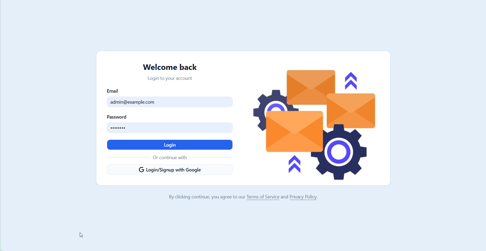
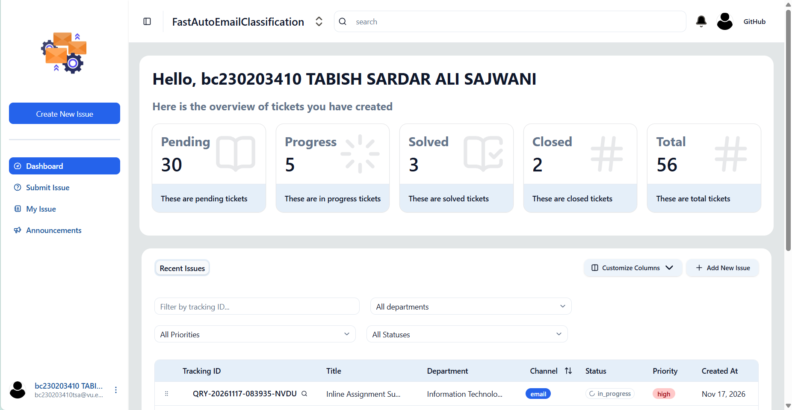
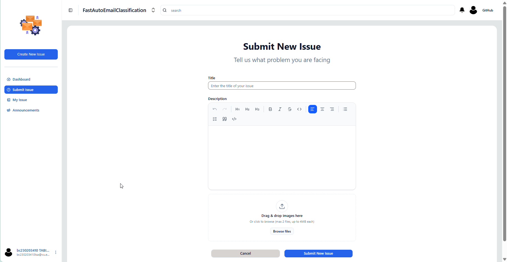
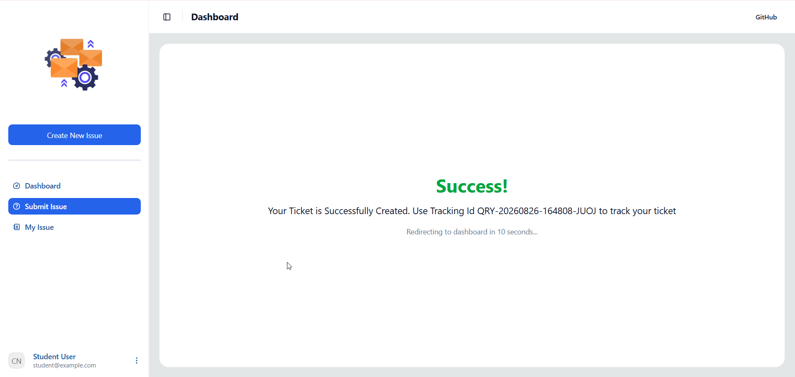
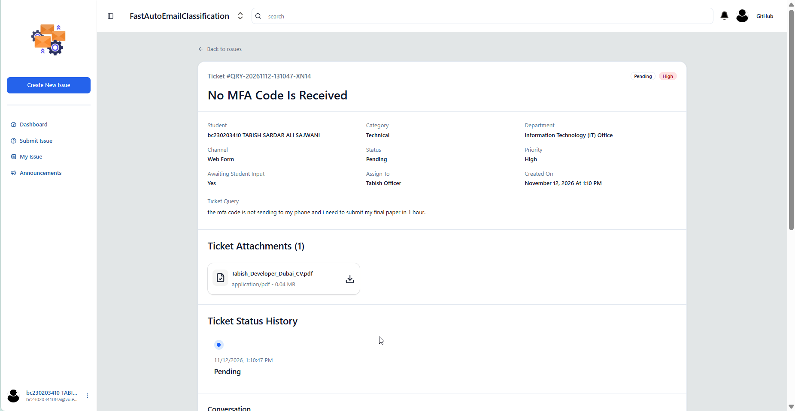
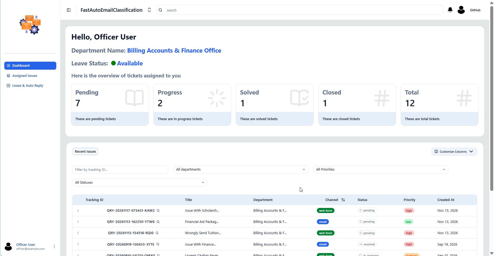
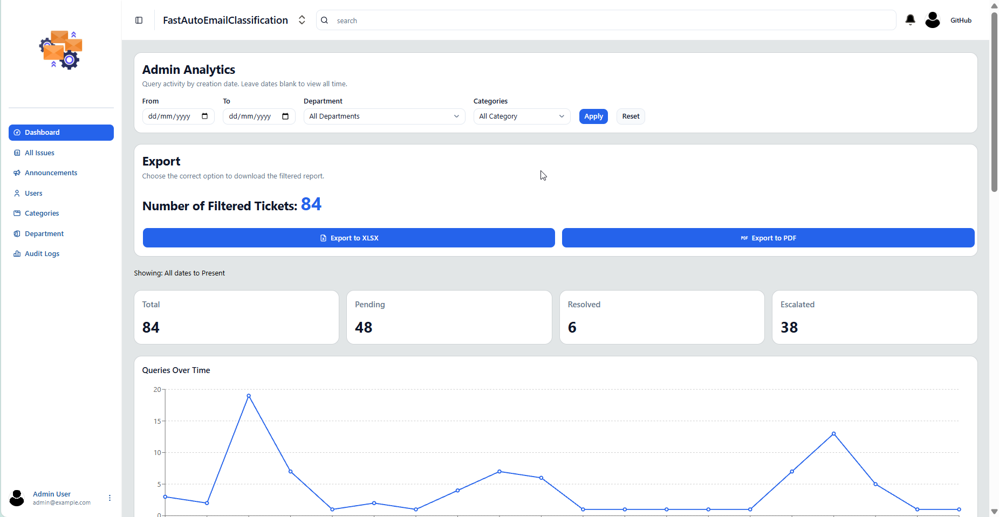

# **Fast Smart Query Automation (an AI Automation and Full Stack Development)**

## 1. **Project Introduction**

Universities receive a large volume of emails and inquiries daily from students, instructors, and administrative departments. The existing manual approach to handling these communications is often time-consuming, inefficient, and susceptible to human error. Students frequently face difficulties identifying the appropriate department or personnel for their concerns, resulting in misdirected queries, delayed responses, and reduced user satisfaction.

This project proposes the development of a **Smart Query Routing and Email Automation System**, an *AI-powered*, *role-based communication platform* designed to streamline and automate query management. 

The system will intelligently **classify incoming queries**, **route them to the appropriate department** or responsible personnel, **generate AI-assisted response drafts**, and **monitor query resolution status** through a centralized dashboard. 

The application provides separate interfaces and permissions for **Students**, **Officers**, **Heads of Departments (HODs)**, and **Administrators**.

## **2. Main Features**

**Functional Requirements:**
-   **FR-01:** Role-based login with Google OAuth2 authentication (All Roles)
-   **FR-02:** Multi-channel query submission via email, and web form
-   **FR-03:** AI-powered query classification and intent detection (System)
-   **FR-04:** Automatic routing to correct department or instructor (System)
-   **FR-05:** AI-generated draft reply suggestions for staff (All Staff)
-   **FR-06:** Real-time query status tracking for students (Student)
-   **FR-07:** 24-hour auto-escalation for unresolved queries (System)
-   **FR-08:** Email notification system (All Roles)
-   **FR-09:** HOD escalation and override capability (HOD)
-   **FR-10:** Admin analytics dashboard with charts and reports (Admin)
-   **FR-11:** Broadcast announcement to students (Admin)
-   **FR-12:** Export query reports to PDF and Excel (Admin / HOD)
-   **FR-13:** Instructor leave and auto-reply mode (Instructor)
-   **FR-14:** Query history and audit log for all system activity (Admin)

**Non-Functional Requirements:**
-   **NFR-01:** Classify incoming queries within 3–5 seconds.
-   **NFR-02:** Maintain at least 95% uptime.
-   **NFR-03:** Support handling multiple concurrent users.
-   **NFR-04:** Should use Google OAuth2 authentication.
-   **NFR-05:** Ensure only authorized roles can access specific functionality.
-   **NFR-06:** Ensure that no submitted query is lost.
-   **NFR-07:** Provide a simple, and responsive experience for all users.
-   **NFR-08:** Follow a modular design to allow maintenance and future updates.
-   **NFR-09:** Must function properly on modern browsers and mobile devices.
-   **NFR-10:** Must maintain logs of all significant activities.
-   **NFR-11:** Achieve approximately 80–90% classification accuracy.
-   **NFR-12:** Display meaningful error messages and recover gracefully.
-   **NFR-13:** Support periodic backups to prevent data loss.
-   **NFR-14:** Must be deployable across cloud platforms and environments.
-   **NFR-15:** Operate entirely using free-tier tools, APIs, and hosting services.


## **3. Technology Used**
-   Python 3.14+/FastAPI (Backend)
-   Javascript/React (Frontend)
-   Tailwind CSS (Styling)
-   PostgreSQL/Supabase (Database)
-   Postman (API Testing)
-   SQLAlchemy (ORM)
-   Pydantic (Validation)
-   Rechart/Chart.js (Visualization)
-   Google Gemini and Claude API (Query Classification)
-   Google OAuth 2 API (Authentication)
    

## **4. Project folder structure**

```text
FastSmartQueryAutomation/
│
├── Backend/
│   ├── alembic/                 # Database migration scripts
│   ├── app/                     # FastAPI application
│   ├── ml/                      # Machine learning and classification
│   ├── seeders/                 # Database seeders
│   ├── uploads/                 # Uploaded files
│   ├── .env                     # Local environment variables (not submitted)
│   ├── .env.example             # Environment variable template
│   ├── .gitignore
│   ├── .python-version
│   ├── alembic.ini
│   ├── pyproject.toml           # Python project dependencies
│   ├── uv.lock                  # Locked Python dependencies
│   └── README.md
│
├── frontend/
│   ├── public/                  # Static public assets
│   ├── src/                     # React application source
│   ├── .env                     # Frontend environment variables
│   ├── .gitignore
│   ├── components.json
│   ├── eslint.config.js
│   ├── index.html
│   ├── package.json
│   └── package-lock.json
│
└── README.md                    # Recommended location for this guide
```

## **5. Prerequisites**

Install the following software before setting up the project:

- Python 3.11 or later
- Node.js and npm
- PostgreSQL
- Git
- uv (Python package and project manager)

You can install uv using the official instructions:

https://docs.astral.sh/uv/getting-started/installation/

Verify the installations:

```bash
python --version
node --version
npm --version
uv --version
```


## **6. Backend installation**

### Step 1: Navigate to the backend directory

Open a terminal in the project directory:

```bash
cd Backend
```

### Step 2: Install Python dependencies

Install the project dependencies using uv:

```bash
uv sync
```

This command creates the project's virtual environment if necessary and installs the dependencies specified in `pyproject.toml` and `uv.lock`.

### Step 3: Configure environment variables

Create a `.env` file in the `Backend` directory using `.env.example` as a template.

On Windows PowerShell:

```powershell
Copy-Item .env.example .env
```

On Linux/macOS:

```bash
cp .env.example .env
```

Update the environment variables with your own local configuration.

Refer to Section 8 for environment configuration.


## **7. Frontend installation**

Open another terminal and navigate to the frontend directory:

```bash
cd frontend
```

Install the frontend dependencies:

```bash
npm install
```

Create the frontend `.env` file if required by the application, using the appropriate example configuration.

Configure the backend API base URL according to the environment variable name used by the frontend source code.

For local development, the backend API is expected to run at:

```text
http://127.0.0.1:8000
```

Start the frontend development server:

```bash
npm run dev
```

Vite will display the local frontend URL in the terminal. The usual development address is:

```text
http://127.0.0.1:5173
```

## **8. Environment Configuration**

The backend requires environment variables for database connectivity, authentication, and external services.

The `.env.example` file provides a template of the required variables.

Typical configuration categories include:

| Configuration | Description |
|---|---|
| Database URL | PostgreSQL connection string |
| Google Client ID | Google OAuth application client ID |
| Google Client Secret | Google OAuth application secret |
| Gemini API Key | API key for Google Gemini |
| JWT Secret Key | Secret used for signing application tokens |
| Gmail Credentials | Gmail API OAuth configuration |
| Frontend URL | Frontend origin used for CORS and related configuration |

Use the exact environment variable names defined in the project's `.env.example` and application settings.

## 9. Database Setup and Migrations

The application uses PostgreSQL as its relational database.

### Step 1: Create a PostgreSQL database

Create an empty database using pgAdmin or the PostgreSQL command line.

For example:

```sql
CREATE DATABASE fast_smart_query_automation;
```

Update the backend database connection string in `.env` to match your PostgreSQL username, password, host, port, and database name.

### Step 2: Run Alembic migrations

Navigate to the backend directory:

```bash
cd Backend
```

Run the migrations:

```bash
uv run alembic upgrade head
```

This applies all available database migrations and creates or updates the database schema.

You can check the current migration version with:

```bash
uv run alembic current
```

To view the available migration heads:

```bash
uv run alembic heads
```

### Step 3: Run database seeders

**After successfully running the migrations, execute the database seeders.**

The seeders insert the initial or required records into the database, such as predefined roles, departments, categories, and other reference data used by the application.

Run the seeder

```bash
uv run python seeders/seed.py
```

## **10. Running the Application**

The backend and frontend should run in separate terminals.

### Start the Backend

Open a terminal:

```bash
cd Backend
```

Start the FastAPI development server:

```bash
uv run fastapi dev
```

The backend should be accessible at:

```text
http://127.0.0.1:8000
```

FastAPI interactive API documentation:

```text
http://127.0.0.1:8000/docs
```

### Start the Frontend

Open another terminal:

```bash
cd frontend
```

Start the Vite development server:

```bash
npm run dev
```

Open the frontend URL displayed by Vite, normally:

```text
http://localhost:5173
```

Make sure the backend is running and the frontend API configuration points to the correct backend address.

## 11. Google OAuth2 and Gmail Configuration

The application uses Google OAuth2 for authentication and Gmail API integration for incoming email processing.

### Google OAuth2 Setup

1. Open the Google Cloud Console:

   https://console.cloud.google.com/

2. Create or select a Google Cloud project.
3. Configure the OAuth consent screen.
4. Create OAuth 2.0 credentials.
5. Add the required authorized redirect URI configured in the backend.
6. Add the Google Client ID and Client Secret to the backend `.env` file.
7. Ensure the Google OAuth application is configured for the intended testing or production users.

The redirect URI configured in Google Cloud Console must match the callback URI used by the application.

### Gmail API Setup

1. Enable the Gmail API in Google Cloud Console.
2. Configure the required OAuth scopes.
3. Provide the Gmail OAuth credentials required by the backend.
4. Complete the OAuth authorization process.
5. Verify that the application can access the authorized mailbox.
6. Verify that the email polling process starts successfully.

The application uses Gmail integration to retrieve eligible incoming messages and create tickets automatically.

## **11. Screenshots**

1.  Login Page


2.  Student Dashboard


3. Submit New Ticket
 

4. New Successful Ticket Submission


5. Ticket Overview


6. Officer Dashboard


7. Admin Dashboard
